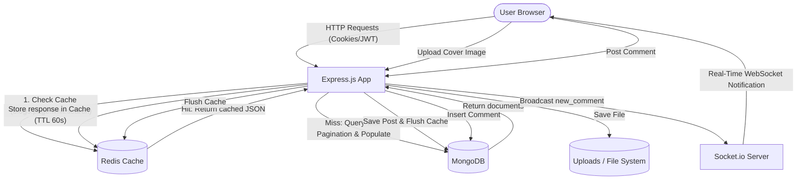

# ✍️ Blogify — Modern Full-Stack Blogging Platform

[](https://nodejs.org/)
[](https://expressjs.com/)
[](https://www.mongodb.com/)
[](https://redis.io/)
[](https://socket.io/)
[](https://www.docker.com/)

**Blogify** is a feature-rich, scalable, full-stack blogging application built using **Node.js**, **Express 5**, **MongoDB**, **Redis**, and **EJS**. It features secure salted password authentication (HMAC-SHA256) with JWT-based cookie sessions, high-performance query caching with automatic invalidation via Redis, real-time WebSocket notifications powered by Socket.io, file upload handling via Multer, full-text title search, and server-side pagination.

---

## 🚀 Features

- **🔐 Robust Authentication & Security**:
  - Secure user registration and login with salt-based **HMAC-SHA256** password hashing.
  - Stateless authentication using **JSON Web Tokens (JWT)** transmitted via HTTP cookies.
  - User role support (`user`, `admin`).
  - Authentication middleware validating session state across protected routes.

- **📝 Content & Media Management**:
  - Create rich blog posts with custom cover image uploads via **Multer**.
  - Dynamic article rendering with calculated reading time and formatted publishing metadata.
  - Real-time client-side cover image preview and character counter.

- **💬 Interactive Comments**:
  - Authenticated readers can participate in post discussions with nested comment feeds.
  - Each comment attributes user identity and profile avatar.

- **⚡ Real-Time Push Notifications**:
  - Bidirectional communication via **Socket.io**.
  - Instant in-app alerts whenever a new comment is posted on any blog.

- **🏎️ Performance & Redis Caching**:
  - High-performance caching for homepage feed, queries, and pagination with configurable TTL (60s).
  - Cache invalidation (`flushAll`) on new blog creation to guarantee immediate freshness.

- **🔍 Search & Pagination**:
  - Server-side regex search by blog title.
  - Server-side numbered pagination with custom page limits.

- **🐳 Dockerized Architecture**:
  - Out-of-the-box multi-container orchestration with Docker Compose (Node app, MongoDB, Redis).

---

## 🛠️ Tech Stack

| Layer | Technology |
|---|---|
| **Runtime & Framework** | [Node.js](https://nodejs.org/) (v18+), [Express.js](https://expressjs.com/) v5 |
| **Database & ODM** | [MongoDB](https://www.mongodb.com/) with [Mongoose](https://mongoosejs.com/) |
| **Caching Layer** | [Redis](https://redis.io/) via `redis` client |
| **Real-Time WebSockets**| [Socket.io](https://socket.io/) |
| **Template Engine** | [EJS](https://ejs.co/) (Embedded JavaScript) with modular partials |
| **Styling & UI** | Bootstrap 5, Bootstrap Icons, Google Fonts (Inter & Merriweather) |
| **Authentication** | Node.js `crypto` (HMAC-SHA256 + 16-byte random salt), `jsonwebtoken`, `cookie-parser` |
| **File Storage** | [Multer](https://github.com/expressjs/multer) (local disk storage in `/public/uploads`) |
| **DevOps & Containers** | Docker, Docker Compose, Nodemon |

---

## 📂 Project Structure

```text
BlogApplication/
├── controllers/          # Controller handlers (expandable architecture)
├── middlewares/          # Custom Express middlewares
│   └── authentication.js # Cookie-based JWT verification middleware
├── models/               # Mongoose data schemas
│   ├── blog.js           # Blog model (title, body, coverImage, author)
│   ├── comment.js        # Comment model (content, blogId, createdBy)
│   └── user.js           # User model (auth, password hashing, token generation)
├── public/               # Static assets served by Express
│   ├── images/           # Default icons and system images
│   └── uploads/          # User-uploaded blog cover images
├── routes/               # Express modular route definitions
│   ├── blog.js           # Blog CRUD, upload, and comment routes
│   └── user.js           # Auth routes (signup, signin, logout)
├── services/             # Helper business logic services
│   └── authentication.js # JWT signing and verification service
├── views/                # EJS template views
│   ├── partials/         # Reusable template components (head, nav, scripts)
│   ├── addBlog.ejs       # Create blog page with image preview
│   ├── blog.ejs          # Single blog view with comment stream
│   ├── home.ejs          # Home page with blog cards, search, and pagination
│   ├── signin.ejs        # Login page
│   └── signup.ejs        # User registration page
├── .dockerignore         # Docker build ignore rules
├── .env                  # Environment configuration (ignored in production)
├── .env.example          # Environment template
├── app.js                # Application entrypoint & server bootstrap
├── docker-compose.yml    # Docker Compose orchestration file
├── Dockerfile            # Container definition for web service
├── package.json          # Node dependencies and scripts
└── README.md             # Project documentation
```

---

## ⚙️ Environment Variables

Create a `.env` file in the root directory (or use `.env.example` as a template):

```env
# Application Port
PORT=8000

# MongoDB Connection String (Local MongoDB or MongoDB Atlas)
MONGO_URL=mongodb://localhost:27017/blogapplication

# Redis Server URL
REDIS_URL=redis://localhost:6379
```

| Variable | Description | Default (if unset) |
|---|---|---|
| `PORT` | Port number on which the Express server listens | `8000` |
| `MONGO_URL` | MongoDB connection URI string | `mongodb://localhost:27017/blogapplication` |
| `REDIS_URL` | Redis instance connection URI | `redis://localhost:6379` |

---

## 🚦 Getting Started

You can run this project either using **Docker Compose** (recommended for quick zero-setup start) or **manually on your host machine**.

### Option 1: Run with Docker Compose (Recommended)

Make sure you have [Docker](https://docs.docker.com/get-docker/) and [Docker Compose](https://docs.docker.com/compose/) installed.

1. **Clone the repository:**
   ```bash
   git clone <repository-url>
   cd BlogApplication
   ```

2. **Configure environment:**
   ```bash
   cp .env.example .env
   ```

3. **Start all services (App, MongoDB, Redis):**
   ```bash
   docker-compose up --build
   ```

4. **Access the application:**
   Open your browser at `http://localhost:8000`.

To run in the background (detached mode):
```bash
docker-compose up -d
```
To stop the containers:
```bash
docker-compose down
```

---

### Option 2: Run Locally (Manual Setup)

#### Prerequisites
- [Node.js](https://nodejs.org/) (v18.x or later)
- [MongoDB](https://www.mongodb.com/try/download/community) running locally or a [MongoDB Atlas](https://www.mongodb.com/atlas) cloud URI
- [Redis](https://redis.io/download/) running locally (e.g., via Redis CLI, WSL, or Docker)

#### Installation Steps

1. **Clone the repository:**
   ```bash
   git clone <repository-url>
   cd BlogApplication
   ```

2. **Install dependencies:**
   ```bash
   npm install
   ```

3. **Configure environment variables:**
   Create a `.env` file in the root directory:
   ```env
   PORT=8000
   MONGO_URL=mongodb://localhost:27017/blogapplication
   REDIS_URL=redis://localhost:6379
   ```

4. **Start the application:**
   - **Development mode (with auto-reload):**
     ```bash
     npm run dev
     ```
   - **Production mode:**
     ```bash
     npm start
     ```

5. **Open in browser:**
   Navigate to `http://localhost:8000`.

---

## 🌐 Routes & API Overview

### Public & Home Routes
| Method | Path | Description | Access |
|---|---|---|---|
| `GET` | `/` | Home page feed with search & pagination (cached with Redis) | Public |

### User Authentication Routes (`/user`)
| Method | Path | Description | Access |
|---|---|---|---|
| `GET` | `/user/signup` | Render sign-up registration form | Public |
| `POST` | `/user/signup` | Register new user, hash password, create JWT, set cookie | Public |
| `GET` | `/user/signin` | Render sign-in login form | Public |
| `POST` | `/user/signin` | Validate credentials, authenticate, set JWT cookie | Public |
| `GET` | `/user/logout` | Clear `token` cookie and redirect to home | Authenticated |

### Blog Routes (`/blog`)
| Method | Path | Description | Access |
|---|---|---|---|
| `GET` | `/blog/add-new` | Render new blog creation page | Authenticated |
| `POST` | `/blog/add-new` | Publish a blog with cover image upload & invalidate cache | Authenticated |
| `GET` | `/blog/:id` | View blog detail, reading time, author, and comments | Public |
| `POST` | `/blog/comment/:blogId` | Submit a comment & emit real-time Socket.io event | Authenticated |

---

## 🏗️ Architecture & Technical Highlights



1. **Cache Layering & Invalidation**:
   The homepage checks Redis under key `blogs:page:<p>:limit:<l>:search:<s>`. If found, the page renders immediately from cache. If not found, MongoDB queries the collection, caches the result for 60 seconds, and serves the page. When any author creates a new post (`POST /blog/add-new`), `req.redisClient.flushAll()` is triggered so all readers see updated content instantly.

2. **Secure Salted Password Hashing**:
   Rather than storing plain passwords or using unsalted hashes, `models/user.js` generates a cryptographically random 16-byte salt via Node's `crypto.randomBytes(16)` during pre-save. The password is then hashed via `crypto.createHmac("sha256", salt)`.

3. **Real-Time Push Notifications**:
   Socket.io is integrated directly with the HTTP server. Whenever a new comment is posted on any blog, the server broadcasts a `new_comment` event containing the post title, alerting active users across the platform in real time.

---

## 🤝 Contributing

Contributions, issues, and feature requests are welcome!
Feel free to open an issue or submit a Pull Request.

1. Fork the Project
2. Create your Feature Branch (`git checkout -b feature/AmazingFeature`)
3. Commit your Changes (`git commit -m 'Add some AmazingFeature'`)
4. Push to the Branch (`git push origin feature/AmazingFeature`)
5. Open a Pull Request

---

## 📄 License

This project is licensed under the [ISC License](package.json).

